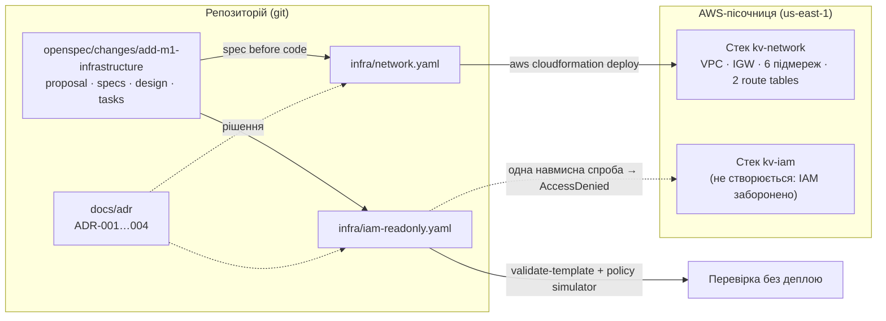
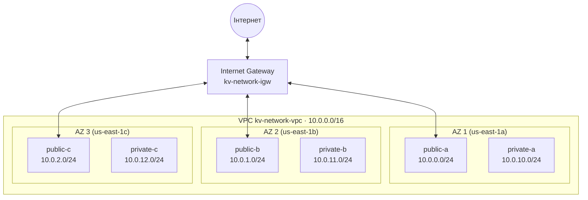
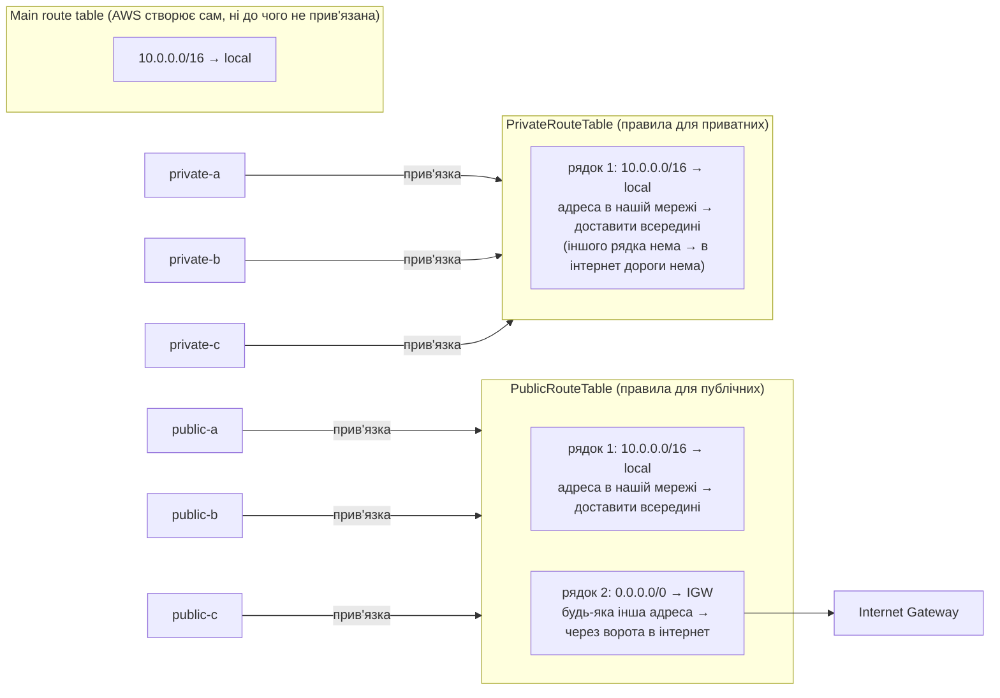
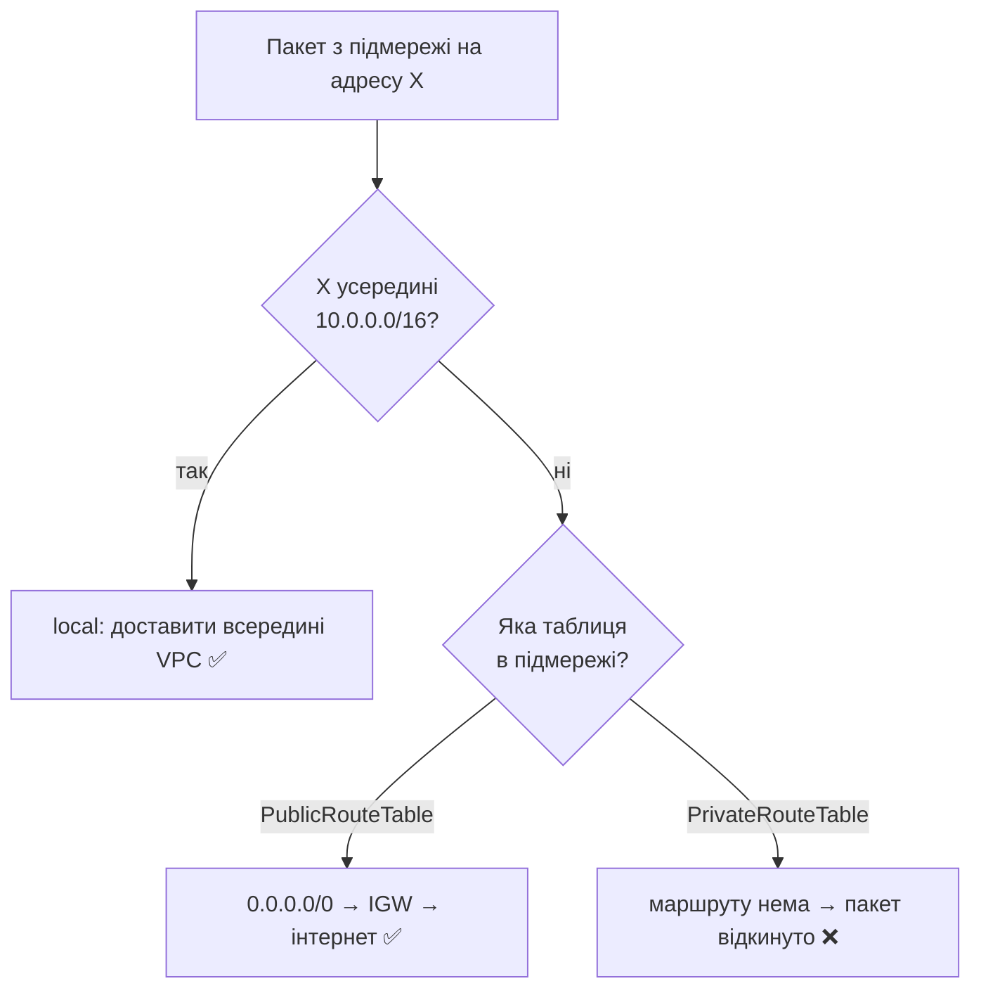
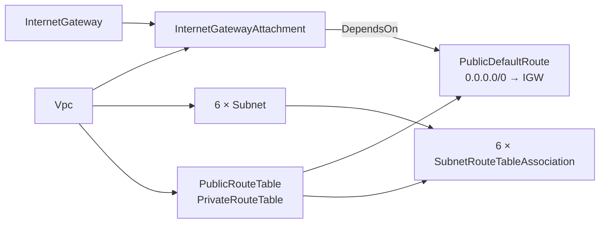
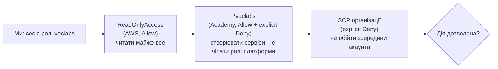
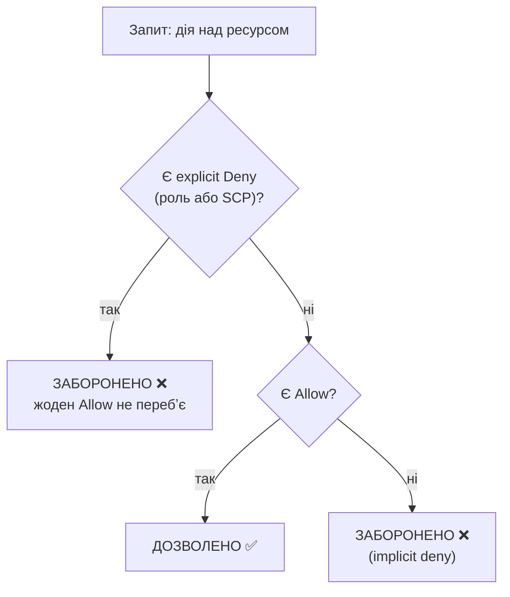
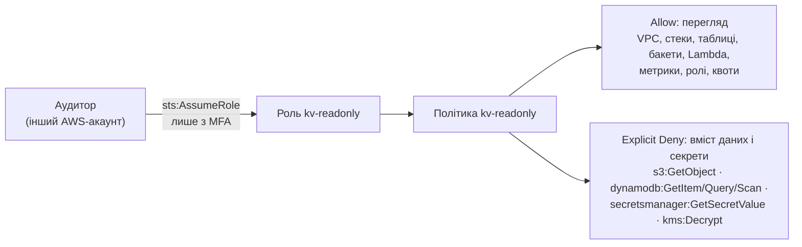
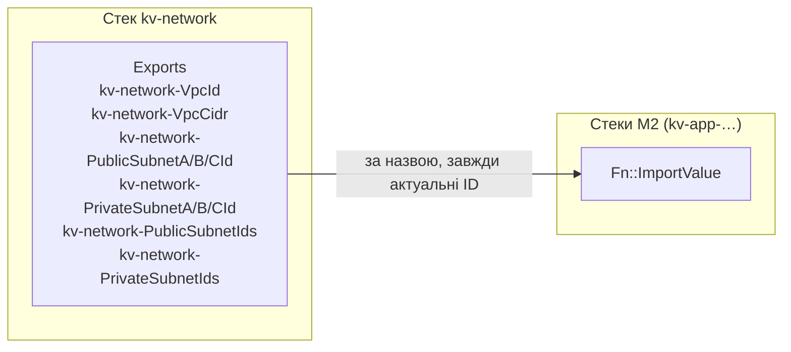

# M1: архітектура в діаграмах

Наочна шпаргалка до M1: що збудовано, як воно пов'язане і чому так. Діаграми у форматі **Mermaid**: GitHub малює їх автоматично; у VS Code — у попередньому перегляді Markdown (Cmd+Shift+V) з розширенням «Markdown Preview Mermaid Support».

Детальні пояснення — у [журналі](journal-uk.md), рішення — в ADR (`docs/adr/`).

---

## 1. Загальна картина M1

Що лежить у репо, що з нього стає в AWS, а що лише перевіряється.

- **Шаблон** (`.yaml`) — бланк замовлення; **стек** — виконане замовлення в AWS (журнал, крок 53).
- Мережу деплоїмо; IAM лише описуємо і перевіряємо, бо пісочниця не дає створювати ролі (ADR-002, розбір ролі).

---

## 2. Мережа: VPC, 3 AZ, 6 підмереж

- **VPC** — «ділянка ЖК з парканом»; **підмережі** — «будинки»; **IGW** — «ворота в місто» (кроки 13, 16).
- Адреса `10.0.X.Y`: `X` = номер підмережі (0–9 публічні, 10–19 приватні; остання цифра = AZ), `Y` = пристрій (ADR-003, крок 25).
- У кожній AZ — **пара** публічна + приватна: падіння однієї AZ не забирає ні вхід, ні дані (крок 57).
- Приватні підмережі **без зв'язку з IGW** — лише для внутрішнього доступу (isolated subnets, крок 23).

---

## 3. Маршрутизація: 2 таблиці, 6 прив'язок

**Як читати:** зліва — підмережі; стрілка «прив'язка» = «ця підмережа користується цією таблицею»; сіра рамка — таблиця, всередині — її рядки (маршрути); стрілка з рядка 2 — куди він веде. Приклад: сервер у `public-b` шле пакет на `8.8.8.8` → дивиться в PublicRouteTable → адреса не в `10.0.0.0/16`, підходить рядок 2 → пакет іде в Internet Gateway → в інтернет. Той самий сервер шле на `10.0.11.5` → підходить рядок 1 → пакет лишається всередині VPC.

- **Route table = навігатор підмережі**: за адресою призначення каже, куди везти пакет (крок 62).
- Таблиць **дві**, прив'язок (`SubnetRouteTableAssociation`) — **шість**: по одній на підмережу (крок 61).
- Єдина різниця таблиць — рядок `0.0.0.0/0 → IGW`. Саме він робить підмережу **публічною**.
- `local` є в кожній таблиці автоматично → усі підмережі бачать одна одну.
- **Main route table** ні до чого не прив'язана і без маршруту до IGW — «забута» підмережа не стане публічною випадково (крок 12).

---

## 4. Куди йде пакет

AWS обирає **найточніший** маршрут (більше число після `/`): для `10.0.11.5` спрацює `local`, а не `0.0.0.0/0` (крок 60).

---

## 5. Як CloudFormation створює ресурси (залежності)

Порядок визначається посиланнями `!Ref` і `DependsOn`, а не порядком у файлі (крок 55).

`DependsOn: InternetGatewayAttachment` — маршрут до воріт можна створити лише після того, як ворота **приєднано** до VPC (крок 57).

---

## 6. Права в пісочниці: три «замки»

| Тип заборони | Текст помилки AWS | Приклад |
|---|---|---|
| implicit deny | `no identity-based policy allows` | `iam:CreateRole` |
| explicit deny у ролі | `explicit deny in an identity-based policy` | `iam:GetRole` на `voclabs` |
| explicit deny від SCP | `explicit deny in a service control policy` | роль `vocareum` |

Детально — [role-dissection.md](role-dissection.md).

---

## 7. Як AWS вирішує «можна чи ні»

Лекція 2, слайди 14–17; контрольне питання 7 (крок 18).

---

## 8. Read-only роль для аудитора (завдання 2–3, не деплоїться)

- **Trust policy** — хто може взяти роль (аудитор з іншого акаунта, з MFA); **permissions policy** — що можна, коли взяв (ADR-004, кроки 27–31).
- Explicit Deny — «запобіжник»: дані закриті, навіть якщо колись хтось розширить Allow (крок 31).

---

## 9. Як M2 підключиться до мережі (Exports)

- Після перестворення мережі (завдання 8) ID підмереж нові — імпорт за назвою бере актуальні (крок 22).
- Поки M2 імпортує значення, CloudFormation не дасть видалити `kv-network` → видаляємо у зворотному порядку: спершу застосунок, потім мережа (ADR-002).
