# M1: архітектура в діаграмах

Наочна шпаргалка до M1: що збудовано, як воно пов'язане і чому так. Діаграми у форматі **Mermaid**: GitHub малює їх автоматично; у VS Code — у попередньому перегляді Markdown (Cmd+Shift+V) з розширенням «Markdown Preview Mermaid Support».

Детальні пояснення — у [журналі](journal-uk.md), рішення — в ADR (`docs/adr/`).

---

## 1. Загальна картина M1

Що лежить у репо, що з нього стає в AWS, а що лише перевіряється.

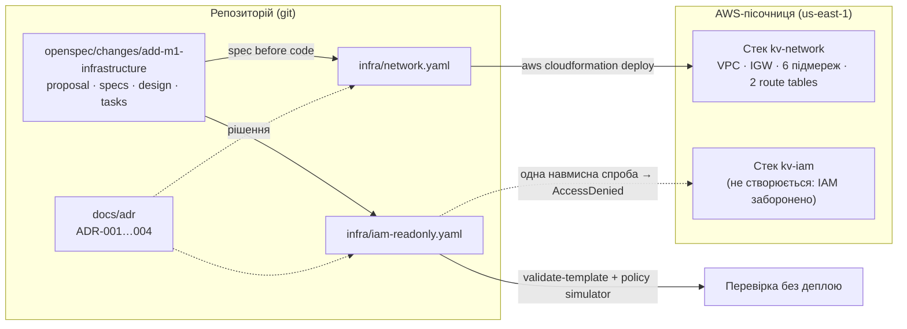

- **Шаблон** (`.yaml`) — бланк замовлення; **стек** — виконане замовлення в AWS (журнал, крок 53).
- Мережу деплоїмо; IAM лише описуємо і перевіряємо, бо пісочниця не дає створювати ролі (ADR-002, розбір ролі).

---

## 2. Мережа: VPC, 3 AZ, 6 підмереж

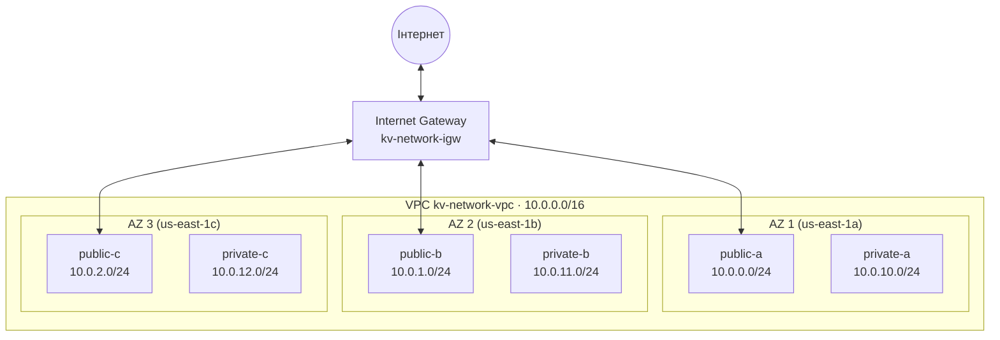

- **VPC** — «ділянка ЖК з парканом»; **підмережі** — «будинки»; **IGW** — «ворота в місто» (кроки 13, 16).
- Адреса `10.0.X.Y`: `X` = номер підмережі (0–9 публічні, 10–19 приватні; остання цифра = AZ), `Y` = пристрій (ADR-003, крок 25).
- У кожній AZ — **пара** публічна + приватна: падіння однієї AZ не забирає ні вхід, ні дані (крок 57).
- Приватні підмережі **без зв'язку з IGW** — лише для внутрішнього доступу (isolated subnets, крок 23).

---

## 3. Маршрутизація: 2 таблиці, 6 прив'язок

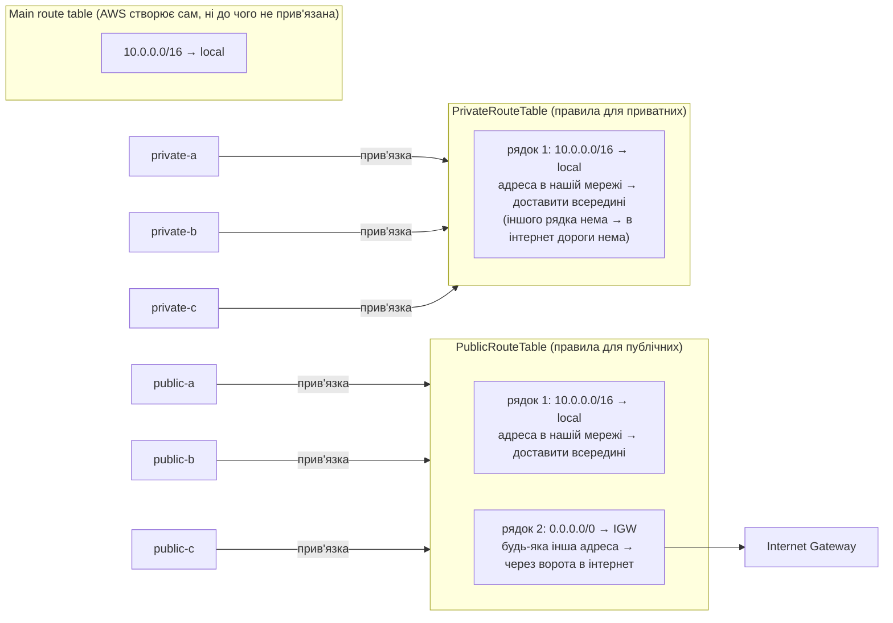

**Як читати:** зліва — підмережі; стрілка «прив'язка» = «ця підмережа користується цією таблицею»; сіра рамка — таблиця, всередині — її рядки (маршрути); стрілка з рядка 2 — куди він веде. Приклад: сервер у `public-b` шле пакет на `8.8.8.8` → дивиться в PublicRouteTable → адреса не в `10.0.0.0/16`, підходить рядок 2 → пакет іде в Internet Gateway → в інтернет. Той самий сервер шле на `10.0.11.5` → підходить рядок 1 → пакет лишається всередині VPC.

- **Route table = навігатор підмережі**: за адресою призначення каже, куди везти пакет (крок 62).
- Таблиць **дві**, прив'язок (`SubnetRouteTableAssociation`) — **шість**: по одній на підмережу (крок 61).
- Єдина різниця таблиць — рядок `0.0.0.0/0 → IGW`. Саме він робить підмережу **публічною**.
- `local` є в кожній таблиці автоматично → усі підмережі бачать одна одну.
- **Main route table** ні до чого не прив'язана і без маршруту до IGW — «забута» підмережа не стане публічною випадково (крок 12).

---

## 4. Куди йде пакет

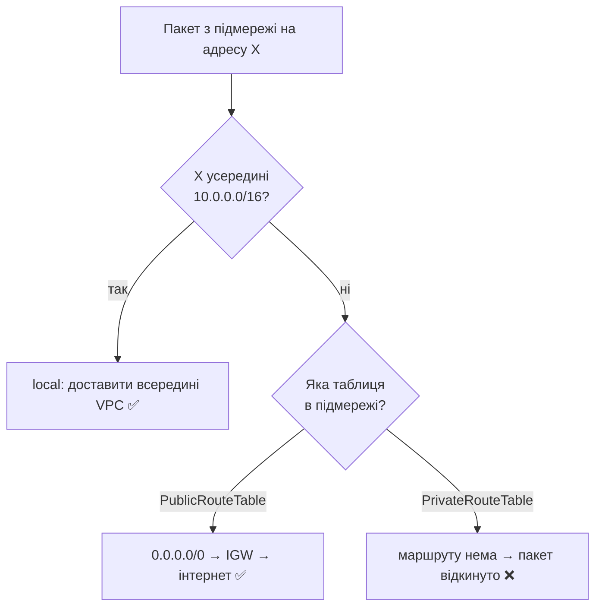

AWS обирає **найточніший** маршрут (більше число після `/`): для `10.0.11.5` спрацює `local`, а не `0.0.0.0/0` (крок 60).

---

## 5. Як CloudFormation створює ресурси (залежності)

Порядок визначається посиланнями `!Ref` і `DependsOn`, а не порядком у файлі (крок 55).

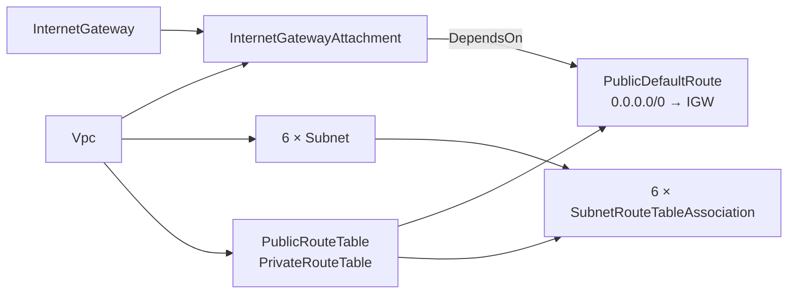

`DependsOn: InternetGatewayAttachment` — маршрут до воріт можна створити лише після того, як ворота **приєднано** до VPC (крок 57).

---

## 6. Права в пісочниці: три «замки»

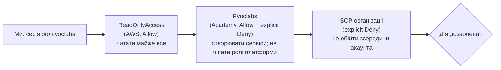

| Тип заборони | Текст помилки AWS | Приклад |
|---|---|---|
| implicit deny | `no identity-based policy allows` | `iam:CreateRole` |
| explicit deny у ролі | `explicit deny in an identity-based policy` | `iam:GetRole` на `voclabs` |
| explicit deny від SCP | `explicit deny in a service control policy` | роль `vocareum` |

Детально — [role-dissection.md](role-dissection.md).

---

## 7. Як AWS вирішує «можна чи ні»

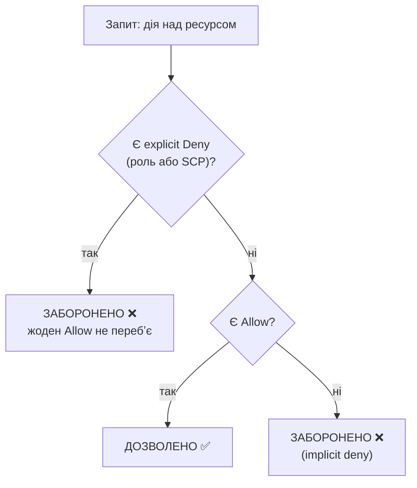

Лекція 2, слайди 14–17; контрольне питання 7 (крок 18).

---

## 8. Read-only роль для аудитора (завдання 2–3, не деплоїться)

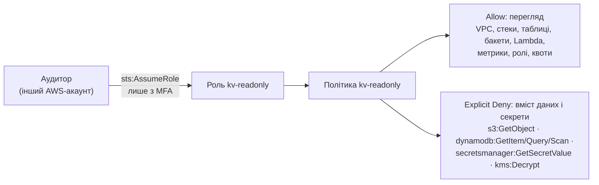

- **Trust policy** — хто може взяти роль (аудитор з іншого акаунта, з MFA); **permissions policy** — що можна, коли взяв (ADR-004, кроки 27–31).
- Explicit Deny — «запобіжник»: дані закриті, навіть якщо колись хтось розширить Allow (крок 31).

---

## 9. Як M2 підключиться до мережі (Exports)

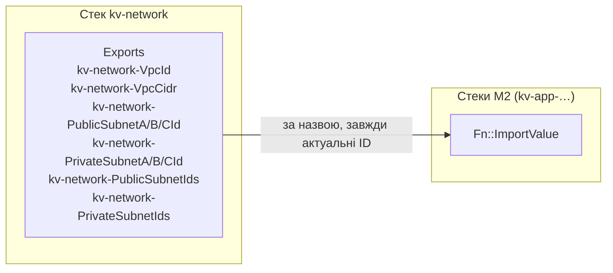

- Після перестворення мережі (завдання 8) ID підмереж нові — імпорт за назвою бере актуальні (крок 22).
- Поки M2 імпортує значення, CloudFormation не дасть видалити `kv-network` → видаляємо у зворотному порядку: спершу застосунок, потім мережа (ADR-002).

---

## 10. Як мережа потрапляє в AWS: change set → execute (завдання 4.3)

**Що зробили.** Не створювали ресурси «наосліп», а спершу попросили CloudFormation **показати план** — change set — і лише після перегляду його виконали.

```bash
# 1. Попередній перегляд: що буде створено (нічого не створює)
aws cloudformation create-change-set \
  --stack-name kv-network --change-set-name initial-create --change-set-type CREATE \
  --template-body file://infra/network.yaml \
  --tags Key=Project,Value=kv-store Key=Milestone,Value=m1 \
  --profile kse-lab
aws cloudformation describe-change-set --stack-name kv-network --change-set-name initial-create --profile kse-lab

# 2. Виконання: CloudFormation створює ресурси
aws cloudformation execute-change-set --stack-name kv-network --change-set-name initial-create --profile kse-lab
aws cloudformation wait stack-create-complete --stack-name kv-network --profile kse-lab
```

**Команди частина за частиною:**

| Частина | Що означає |
|---|---|
| `aws cloudformation` | звертаємось до сервісу CloudFormation |
| `create-change-set` | «підготуй план змін» (нічого не створює) |
| `--stack-name kv-network` | для якого стека план (стека ще нема — з'явиться оболонка `REVIEW_IN_PROGRESS`) |
| `--change-set-name initial-create` | назва плану — щоб потім виконати саме його |
| `--change-set-type CREATE` | стека ще нема → план **створення** (для наявного стека — `UPDATE`) |
| `--template-body file://infra/network.yaml` | шаблон з диска (`file://` = «прочитай файл») |
| `--tags Key=…,Value=…` | теги на весь стек → CloudFormation чепить їх на кожен ресурс |
| `--profile kse-lab` | які ключі використати (наш профіль пісочниці) |
| `describe-change-set` | показати план: список `Action` (`Add`/`Modify`/`Remove`) для кожного ресурсу |
| **`execute-change-set`** | «**виконуй** цей план»: CloudFormation починає реально створювати ресурси; стек переходить у `CREATE_IN_PROGRESS` |
| `--stack-name kv-network --change-set-name initial-create` | який саме план виконати (у стека може бути кілька планів) |
| `wait stack-create-complete` | чекати, поки стек стане `CREATE_COMPLETE` (або повідомити про помилку) |

Після `execute-change-set` план «використано»: щоб змінити стек ще раз, створюємо **новий** change set (тип `UPDATE`).

**Порівняння з `aws cloudformation deploy`:** `deploy` робить те саме однією командою (створює change set і одразу виконує). Ми розділили на два кроки, щоб **переглянути план до виконання**.

**Результат першого деплою (2026-11-01):** change set — 18 × `Add`; після `execute-change-set` стек `kv-network` = `CREATE_COMPLETE` за ~63 с від команди (перший ресурс `Vpc` готовий о 00:19:36 UTC, стек — о 00:20:03 UTC); теги стека `Project=kv-store`, `Milestone=m1`; 10 експортів `kv-network-…` на місці. VPC `vpc-0762773ace736d258`.

**Що означає change set.** «Список змін» між тим, що є в AWS зараз, і тим, що описано в шаблоні: які ресурси буде **додано** (`Add`), **змінено** (`Modify`, з позначкою, чи доведеться ресурс **замінити**) або **видалено** (`Remove`). Перегляд нічого не змінює; виконати його — окрема команда.

**Навіщо.** Побачити наслідки **до** того, як вони стались: що нічого зайвого (наприклад, платного NAT) не створиться і нічого потрібного не видалиться. Для першого створення це перевірка «шаблон = очікування» (у нас — 18 × `Add`); для майбутніх оновлень — захист від випадкового видалення чи заміни ресурсу. Change set — відповідь на питання «**що станеться?**» (до зміни); drift detection — «**чи змінив хтось руками?**» (після). Контрольне питання 9.

**Як CloudFormation створює ресурси.**

```mermaid
sequenceDiagram
    participant Me as Ми (Mac, AWS CLI)
    participant CFN as CloudFormation (в AWS)
    participant EC2 as Сервіс EC2/VPC (в AWS)

    Me->>CFN: create-change-set (шаблон network.yaml)
    CFN-->>Me: план: 18 × Add
    Me->>CFN: execute-change-set
    Note over CFN: будує граф залежностей з !Ref і DependsOn
    CFN->>EC2: CreateVpc, CreateInternetGateway (паралельно)
    EC2-->>CFN: vpc-…, igw-…
    CFN->>EC2: AttachInternetGateway, CreateSubnet ×6, CreateRouteTable ×2
    EC2-->>CFN: subnet-…, rtb-…
    CFN->>EC2: CreateRoute 0.0.0.0/0 → igw (після Attach), AssociateRouteTable ×6
    EC2-->>CFN: готово
    Note over CFN: записує: логічне ім'я → реальний ID; статус CREATE_COMPLETE
    Me->>CFN: describe-stacks / list-stack-resources
    CFN-->>Me: статус, Outputs, ресурси
```

1. Ми лише **надсилаємо шаблон** — уся робота відбувається **на боці AWS**. Тому, навіть якщо сесія лаби закінчиться посеред деплою, CloudFormation продовжить.
2. CloudFormation **будує граф залежностей**: з `!Ref Vpc` бачить, що підмережі чекають на VPC; з `DependsOn` — що маршрут чекає на приєднання воріт (діаграма 5). Незалежні ресурси створює **паралельно**.
3. Для кожного ресурсу **викликає API відповідного сервісу** (`ec2:CreateVpc`, `ec2:CreateSubnet`…) — **з нашими правами** (сесія ролі `voclabs`). Тому важливо, що симулятор показав `ec2:CreateVpc` = allowed (role-dissection, розділ 5).
4. **Запам'ятовує** відповідність «логічне ім'я в шаблоні → реальний ID» (`Vpc → vpc-0a1b…`) — це і є стек.
5. Якщо хоч один ресурс не створився — **rollback**: видаляє все, що встиг створити (стек атомарний, ADR-002).

---

## 11. Drift detection: чи збігається AWS з шаблоном (завдання 4.8)

**Що таке drift («дрейф»).** Стан, коли реальні ресурси в AWS **відпливли** від того, що описано в шаблоні: хтось змінив їх **руками** (у консолі, CLI) в обхід CloudFormation. **Drift detection** — перевірка, яку запускає CloudFormation: порівнює кожен ресурс стека з шаблоном і каже, що змінено.

**Аналогія.** Будинок збудовано за кресленням. Потім хтось перефарбував двері, а креслення не оновив — тепер креслення **бреше**. Drift detection — інспектор, який обходить будинок з кресленням у руках і записує розбіжності.

**Навіщо.** Головна обіцянка IaC: **код = правда**. Ручні зміни її ламають:
- при перестворенні з шаблону (завдання 8) ручна зміна **зникне** — і щось перестане працювати;
- наступне оновлення стека може **перезаписати** ручну зміну без попередження;
- на захисті не поясниш «чому так», якщо цього нема в коді.

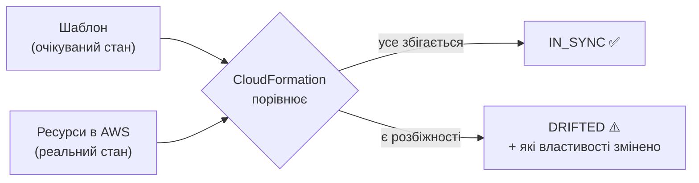

**Статуси.** Стек: `IN_SYNC` (збігається) / `DRIFTED` (є розбіжності). Кожен ресурс: `IN_SYNC`, `MODIFIED` (змінено властивості), `DELETED` (видалено руками), `NOT_CHECKED` (тип ресурсу перевірку не підтримує).

**Команди:**
```bash
# запустити перевірку (повертає ID перевірки)
aws cloudformation detect-stack-drift --stack-name kv-network --profile kse-lab
# статус перевірки і загальний результат стека
aws cloudformation describe-stack-drift-detection-status --stack-drift-detection-id <ID> --profile kse-lab
# деталі по кожному ресурсу: що очікувалось, що насправді
aws cloudformation describe-stack-resource-drifts --stack-name kv-network --profile kse-lab
```

**Обмеження (важливо для захисту).**
- Бачить зміни **властивостей ресурсів, що вже є в стеку**. **Не бачить** нових ресурсів, доданих руками поза стеком (наприклад, зайвий маршрут у таблиці як окремий об'єкт).
- Не всі типи ресурсів підтримують перевірку (`NOT_CHECKED`).
- Перевірка лише **показує** розбіжності, сама нічого не виправляє.

**Change set vs drift detection** (контрольне питання 9):

| | Change set | Drift detection |
|---|---|---|
| Коли | **до** зміни | **після** |
| Порівнює | шаблон **новий** ↔ стек | шаблон **поточний** ↔ реальні ресурси |
| Питання | «що станеться, якщо застосую?» | «чи змінив хтось руками?» |

---

## 12. Як працює шаблон IAM (ресурси і зв'язки)

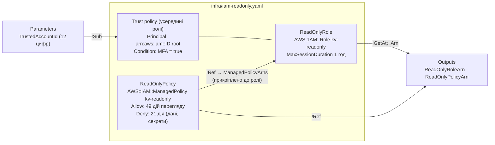

- **Політика** — ЩО можна; **роль** — картка, до якої політику прикріплено; **trust policy** — КОМУ видавати картку (README, розділ «M1 — IAM read-only»).
- Ролі можуть мати кілька політик; у `kv-readonly` — свідомо одна (spec).

## 13. Як аудитор користувався б роллю (у справжньому акаунті)

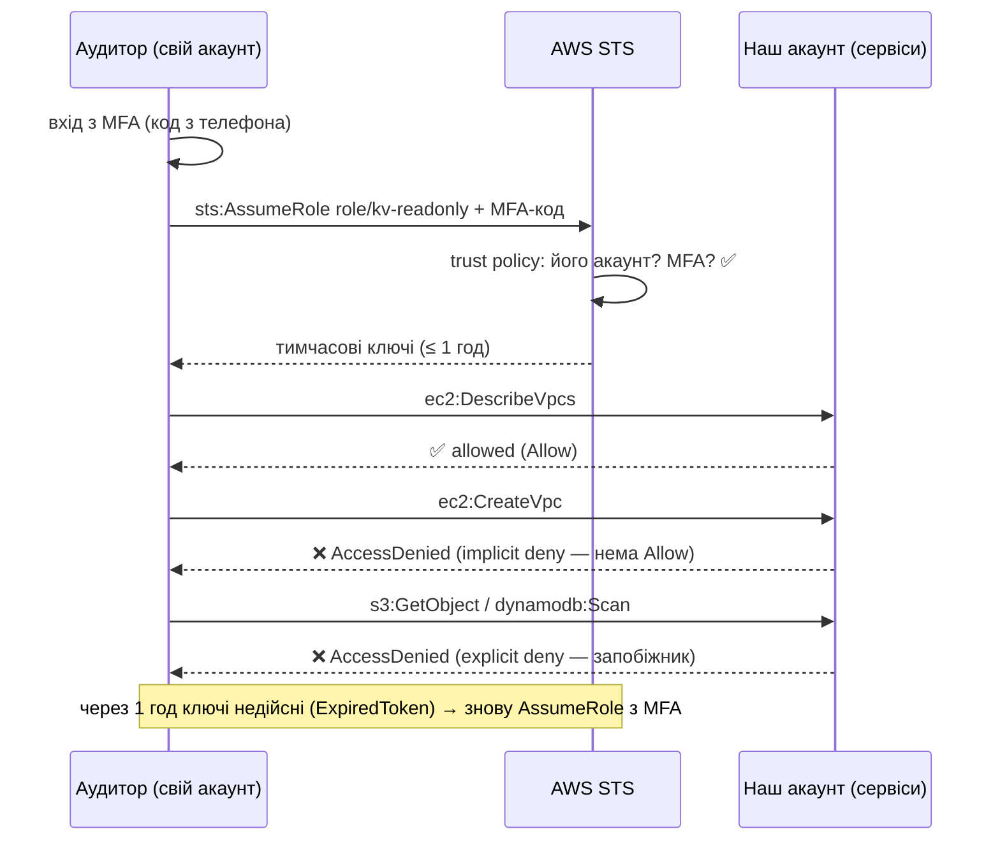

## 14. Як ми перевіряємо IAM без деплою (завдання 5.2)

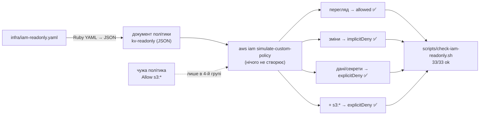

Симулятор — «льотний тренажер»: проганяє той самий алгоритм, що й справжній AWS (explicit Deny → Allow → implicit deny, діаграма 7), але без реального запиту.
